<picture>
  <source media="(prefers-color-scheme: dark)" srcset="https://profile-live.anuragftw1912.workers.dev/?theme=dark">
  
</picture>

<a href="https://github.com/fatfreebutter">
  <picture>
    <source media="(prefers-color-scheme: dark)" srcset="https://raw.githubusercontent.com/fatfreebutter/fatfreebutter/main/dark_mode.svg">
    
  </picture>
</a>

[Website](https://fatfreebutter.github.io) · [linmap3d live demo](https://fatfreebutter.github.io/linmap3d/)
